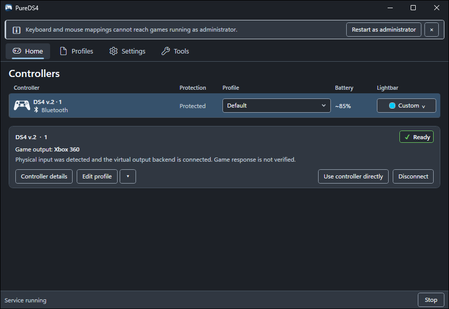
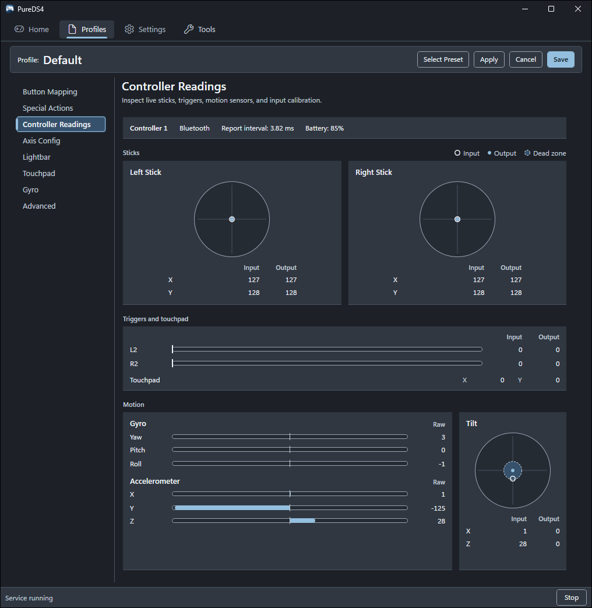

# PureDS4


PureDS4 lets you use a **DualShock 4** controller in Windows games. Connect it
over USB or Bluetooth, pick a profile, and games see an **Xbox 360** or
**DualShock 4** controller. You can remap buttons, adjust sticks and triggers,
use the gyro and touchpad, and set rumble and the lightbar.

Need Steam or a game to use the real DS4 instead? Switch to
[direct use](#use-the-ds4-directly) from Home without closing PureDS4.

PureDS4 supports the **DualShock 4 only** (no DualSense, Switch Pro or
Joy-Con) on **Windows 10/11 x64**. It is maintained by
[meiameiameia](https://github.com/meiameiameia) and based on
[DS4Windows](https://github.com/hbashton/DS4Windows); for other controllers,
use DS4Windows.

<a href="docs/images/screenshots/home.png">
  
</a>

<details>
<summary>More: live controller readings in the profile editor</summary>

<a href="docs/images/screenshots/controller-readings.png">
  
</a>

</details>

## Download and install

The current version is **26.11.0**, with a new look in light and dark mode.
Download it from [Releases](https://github.com/meiameiameia/PureDS4/releases):

- **`PureDS4_26.11.0_Setup_x64.exe`**: the normal installer (recommended).
- **`PureDS4_26.11.0_x64.zip`**: portable version. It still needs the drivers
  that the installer sets up; PureDS4 offers to install them.

If you use DS4Windows now, read [coming from DS4Windows](#coming-from-ds4windows)
first. Then:

1. Run the installer. Keep the recommended **HidHide** option: it stops games
   from seeing the controller twice.
2. Restart Windows if setup asks you to.
3. Open PureDS4, connect your DS4, and choose a profile and game output on
   Home. When the controller shows **Ready**, start your game.

The installer is **unsigned (no verified publisher)**, so Windows SmartScreen
may warn you. Download only from the Releases page above. To check the
download, compare its hash with `SHA256SUMS.txt` on the same page:

```powershell
Get-FileHash .\PureDS4_26.11.0_Setup_x64.exe -Algorithm SHA256
```

Don't turn off Windows protections to install PureDS4.

**Updates:** PureDS4 checks for new versions once a day and tells you; you
download and install them yourself. You can turn this off in Settings or check
in **Tools → Updates**. Installing a new version over an old one keeps your
profiles and settings; backing them up first is still a good idea.

## Use the DS4 directly

On Home, choose **Use controller directly** to hand the real DS4 to Windows,
so Steam or a game with its own DS4 support can use it. Your profile is not
applied while in this mode. Choose **Use game output** to switch back. Do this
before starting the game; the game or Steam may need a restart to notice.

## Coming from DS4Windows

PureDS4 replaces DS4Windows; don't run both. Back up your DS4Windows profiles,
close DS4Windows completely (including its tray icon) and uninstall it. Leave
shared drivers such as HidHide in place. Then, in PureDS4, use
**Tools → Import from DS4Windows** to copy your game profiles. Auto Profiles,
special actions and app settings are not imported.

The [installation and recovery guide](docs/INSTALL_AND_ROLLBACK.md) covers
portable DS4Windows versions, repair and going back.

## Good to know

PureDS4 is tested by its maintainer on one PC with a DS4 v2, over USB and
Bluetooth. Things to be aware of:

- **Short Bluetooth pauses:** on the test PC, Bluetooth input sometimes pauses
  for under a second (rarely up to 3 seconds) about every 15 minutes, then
  continues. It wasn't noticeable in game, and the cause is still being
  investigated.
- **Not tested yet:** sleep/wake, two controllers at once, and the DS4
  speaker and headset jack.
- **Keyboard and mouse mappings** may not reach games running as
  administrator unless PureDS4 also runs as administrator.
- If an installation fails partway, it may need a manual repair.

Full test records: [hardware validation](docs/HARDWARE_VALIDATION.md) and
[installer validation](docs/INSTALLER_VALIDATION_STRATEGY.md).

## Problems and support

- Input missing or wrong? Open **Profiles → edit a profile → Controller
  Readings** to see what the controller sends and what the game receives.
- Setup or update failed? Save the error message, restart if asked, and run
  the PureDS4 installer again to repair. Don't delete shared drivers.

Report problems in [Issues](https://github.com/meiameiameia/PureDS4/issues)
with your PureDS4 and Windows versions, USB or Bluetooth, the game output you
chose, and what happened. Logs are in `%AppData%\PureDS4\Logs` (setup logs in
`%ProgramData%\PureDS4\Installer`); remove your username, paths and controller
address before posting excerpts.

## For developers

Build and test from a Windows development environment with the project's
.NET SDK:

```powershell
dotnet restore PureDS4.sln --locked-mode
dotnet build PureDS4.sln -c Debug -p:Platform=x64
dotnet test PureDS4.sln -c Debug -p:Platform=x64 -r win-x64 -p:SelfContained=true --filter "FullyQualifiedName!~LiveProcessCapture"
```

These commands do not validate hardware or the full installer. See the
[installer documentation](installer/README.md) and the
[release contract](docs/RELEASE_CONTRACT.md) for packaging, versions
(year.month from 26.11.0), the bundled .NET 10 runtime and release rules.

## Credits and license

PureDS4 builds on [hbashton/DS4Windows](https://github.com/hbashton/DS4Windows)
and the DS4Windows contributors before it. The upstream history, original
copyright notices and GPL notices are preserved; the `upstream-baseline` tag
records the fork's starting point.

PureDS4 is licensed under **GPL-3.0-or-later** (see [COPYING](COPYING)).
Bundled components keep their own licenses: setup shows the Microsoft runtime
and Windows SDK terms, and the portable ZIP includes them to read before use.
These are not an extra PureDS4 EULA. Details:
[component provenance](docs/component-provenance.md),
[managed dependency notices](PureDS4/ThirdParty/ManagedDependencies.NOTICE.txt),
[controller artwork attribution](PureDS4/Resources/ControllerArtwork.NOTICE.txt)
and the bundled backend's source at
[PureDS4-VIIPER](https://github.com/meiameiameia/PureDS4-VIIPER).
